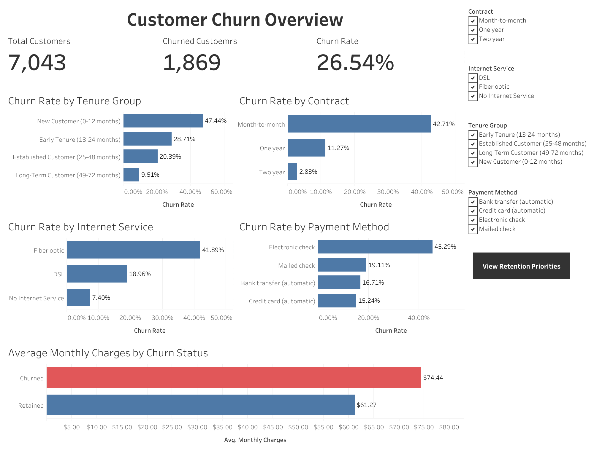
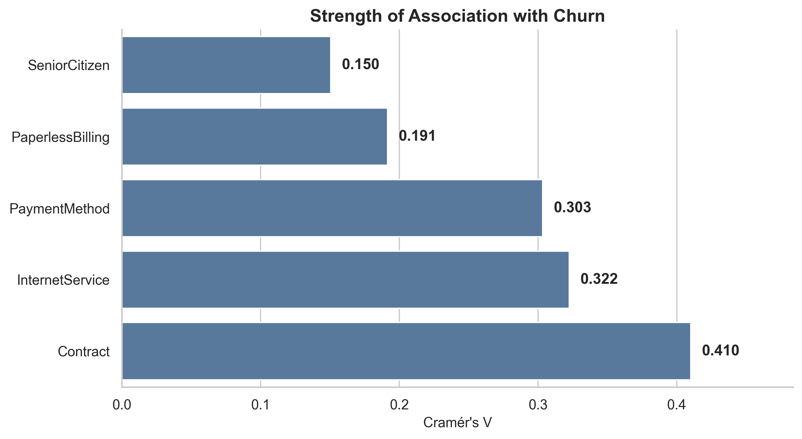
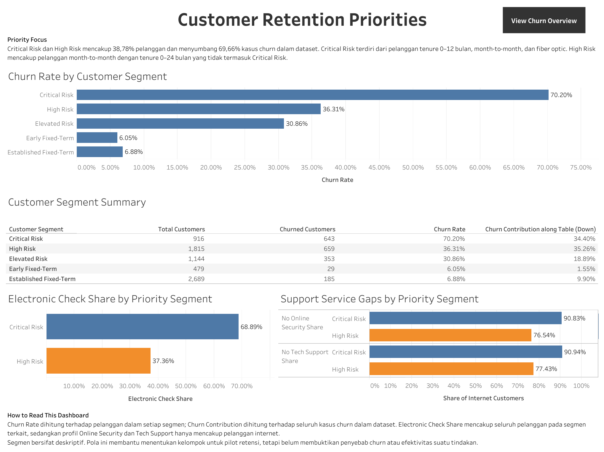

# Customer Churn Analysis

Analisis customer churn pada perusahaan telekomunikasi fiktif menggunakan Python dan Tableau. Project ini bertujuan mengidentifikasi kelompok pelanggan dengan churn tinggi, memahami karakteristik yang berkaitan dengan churn, dan menyusun prioritas program retensi berdasarkan hasil analisis.



[View Interactive Dashboard on Tableau Public](https://public.tableau.com/app/profile/muhammad.jundullah3944/viz/CustomerChurnAnalysis_17911018556860/ChurnOverview?publish=yes)

---

## Project Overview

Customer churn adalah kondisi ketika pelanggan berhenti menggunakan layanan perusahaan. Tingkat churn yang tinggi dapat mengurangi basis pelanggan dan pendapatan berulang, sekaligus meningkatkan kebutuhan perusahaan untuk memperoleh pelanggan baru.

Project ini menggunakan IBM Telco Customer Churn Dataset yang menggambarkan 7.043 pelanggan dari sebuah perusahaan telekomunikasi fiktif. Python digunakan untuk data cleaning, exploratory data analysis, statistical analysis, dan customer segmentation. Tableau digunakan untuk menyajikan hasil analisis dalam dashboard interaktif.

Hasil analisis menunjukkan bahwa churn tidak tersebar secara merata. Churn lebih banyak terkonsentrasi pada pelanggan baru, pengguna kontrak month-to-month, pelanggan fiber optic, pengguna electronic check, dan pelanggan tanpa layanan dukungan tertentu.

---

## Business Problem

Mengetahui jumlah pelanggan yang mengalami churn belum cukup untuk menentukan tindakan retensi. Perusahaan perlu memahami kelompok pelanggan mana yang memiliki churn rate lebih tinggi dan karakteristik apa yang membedakan mereka dari pelanggan yang bertahan.

Tanpa prioritas yang jelas, program retensi dapat diberikan terlalu luas kepada seluruh pelanggan. Hal tersebut berpotensi meningkatkan biaya dan memberikan penawaran kepada pelanggan yang sebenarnya memiliki churn rate rendah.

Pertanyaan utama dalam project ini adalah:

> Kelompok pelanggan mana yang menunjukkan churn paling tinggi, karakteristik apa yang membedakan mereka, dan bagaimana perusahaan dapat memprioritaskan upaya retensi berdasarkan pola tersebut?

---

## Analysis Objectives

Analisis ini bertujuan untuk:

1. Mengukur jumlah pelanggan dan churn rate secara keseluruhan.
2. Mengidentifikasi karakteristik pelanggan yang berkaitan dengan churn.
3. Membandingkan churn berdasarkan tenure, demografi, kontrak, pembayaran, biaya, dan layanan.
4. Mengukur signifikansi dan kekuatan hubungan beberapa karakteristik pelanggan dengan churn.
5. Membentuk customer segment sebagai dasar penentuan prioritas retensi.
6. Menyusun rekomendasi bisnis berdasarkan hasil analisis.
7. Menyajikan hasil analisis melalui dashboard Tableau.

---

## Dataset

Project ini menggunakan [IBM Telco Customer Churn Dataset](https://github.com/IBM/telco-customer-churn-on-icp4d).

Dataset awal terdiri dari:

- **7.043 pelanggan**
- **21 kolom**
- **1.869 pelanggan churn**
- **Overall churn rate sebesar 26,54%**

Data mencakup beberapa kelompok informasi:

| Category | Examples |
|---|---|
| Customer demographics | Gender, Senior Citizen, Partner, Dependents |
| Customer relationship | Tenure dan Contract |
| Services | Phone Service, Internet Service, Online Security, Tech Support, dan layanan tambahan lainnya |
| Billing | Paperless Billing, Payment Method, Monthly Charges, dan Total Charges |
| Target variable | Churn |

Setelah data cleaning dan feature engineering, dataset diperkaya dengan:

- `ChurnFlag`
- `TenureGroup`
- `InternetAddOnCount`
- `CustomerSegment`

Processed dataset yang digunakan dalam analisis dan dashboard tersedia di `data/processed/telco_churn_clean.csv`.

---

## Tools and Technologies

| Tool | Usage |
|---|---|
| Python | Bahasa pemrograman utama untuk analisis |
| Pandas | Data cleaning, transformation, aggregation, dan segmentation |
| NumPy | Perhitungan dan pembuatan aturan segmentasi |
| Matplotlib dan Seaborn | Visualisasi data |
| SciPy | Statistical testing |
| Jupyter Notebook | Dokumentasi dan reproducible analysis |
| Tableau | Interactive dashboard |
| Visual Studio Code | Development environment |

---

## Analysis Workflow

```text
Business Understanding
→ Data Cleaning
→ Feature Engineering
→ Exploratory Data Analysis
→ Statistical Analysis
→ Customer Segmentation
→ Business Recommendations
→ Tableau Dashboard
```

Metode statistik yang digunakan mencakup:

- Chi-square test
- Cramér’s V
- Welch’s t-test
- Cohen’s d

Detail proses, kode, output, dan interpretasi tersedia pada [Jupyter Notebook](notebooks/customer-churn-analysis.ipynb).

---

## Key Findings

### Overall Churn

Sebanyak **1.869 dari 7.043 pelanggan** mengalami churn, menghasilkan overall churn rate sebesar **26,54%**.

### Churn Is Concentrated Among New Customers

Kelompok `New Customer` dengan tenure 0–12 bulan memiliki churn rate sebesar **47,44%**, sedangkan pelanggan dengan tenure 49–72 bulan memiliki churn rate sebesar **9,51%**.

Tenure digunakan sebagai penanda fase customer lifecycle. Perbedaan tersebut tidak membuktikan bahwa tenure pendek secara langsung menyebabkan churn.

### Contract Has the Strongest Categorical Association

Pelanggan dengan kontrak month-to-month memiliki churn rate sebesar **42,71%**, dibandingkan **11,27%** pada kontrak satu tahun dan **2,83%** pada kontrak dua tahun.

Sekitar **88,55% pelanggan churn** menggunakan kontrak month-to-month. `Contract` juga memiliki hubungan kategorikal terkuat dengan churn, dengan Cramér’s V sebesar **0,410**.



### Service and Billing Characteristics

Beberapa karakteristik menunjukkan churn rate yang lebih tinggi:

- Fiber optic: **41,89%**
- Electronic check: **45,29%**
- Tanpa Online Security: **41,77%**
- Tanpa Tech Support: **41,64%**
- Rata-rata Monthly Charges pelanggan churn: **$74,44**
- Rata-rata Monthly Charges pelanggan bertahan: **$61,27**

Hubungan tersebut digunakan sebagai sinyal untuk memahami profil pelanggan dan tidak membuktikan hubungan sebab-akibat.

### Priority Customer Segments

Rule-based segmentation menghasilkan dua kelompok prioritas:

- `Critical Risk` mencakup **13,01% pelanggan**, memiliki churn rate **70,20%**, dan menyumbang **34,40%** dari seluruh churn.
- `High Risk` mencakup **25,77% pelanggan**, memiliki churn rate **36,31%**, dan menyumbang **35,26%** dari seluruh churn.

Jika digabungkan, kedua segmen mencakup sekitar **38,78% pelanggan**, tetapi menyumbang sekitar **69,66% dari seluruh churn**.

Segmentasi ini merupakan alat prioritas berbasis pola historis dan tidak menghasilkan probabilitas churn untuk pelanggan individual.

---

## Tableau Dashboard

Dashboard Tableau dibuat menggunakan processed dataset dan terdiri dari dua bagian:

### Churn Overview

Menampilkan:

- Total customers
- Churned customers
- Overall churn rate
- Churn rate by tenure group
- Churn rate by contract
- Churn rate by internet service
- Churn rate by payment method
- Average monthly charges by churn status

### Retention Priorities

Menampilkan:

- Churn rate by customer segment
- Customer count dan churn contribution
- Electronic check share
- Online Security dan Tech Support gaps
- Profil segmen `Critical Risk` dan `High Risk`

[View Interactive Dashboard on Tableau Public](https://public.tableau.com/app/profile/muhammad.jundullah3944/viz/CustomerChurnAnalysis_17911018556860/ChurnOverview?publish=yes)



Tableau packaged workbook tersedia di `tableau/Customer Churn Analysis.twbx`.

---

## Business Recommendations

Berdasarkan hasil analisis, perusahaan dapat menguji beberapa tindakan berikut:

1. **Strengthen early customer onboarding**  
   Memberikan onboarding dan proactive check-in selama 30–90 hari pertama.

2. **Review the fiber optic customer experience**  
   Mengevaluasi instalasi, gangguan teknis, kualitas koneksi, dan kesesuaian biaya.

3. **Offer voluntary contract migration**  
   Menguji penawaran migrasi dari kontrak month-to-month ke kontrak satu tahun.

4. **Test support-service bundles**  
   Menguji penawaran Online Security atau Tech Support kepada pelanggan internet dalam segmen prioritas.

5. **Encourage automatic payment adoption**  
   Menyederhanakan proses migrasi dari electronic check ke automatic payment.

Rekomendasi tersebut merupakan hipotesis tindakan berdasarkan pola historis. Efektivitasnya perlu diuji melalui program pilot atau eksperimen terkontrol.

---

## Repository Structure

```text
Customer-Churn-Analysis/
├── data/
│   ├── raw/
│   │   └── Telco-Customer-Churn.csv
│   └── processed/
│       └── telco_churn_clean.csv
├── images/
│   ├── categorical_effect_sizes.png
│   ├── contract_billing_churn_rate.png
│   ├── customer_segment_churn_rate.png
│   ├── overall_churn_distribution.png
│   ├── tableau_churn_overview.png
│   ├── tableau_retention_priorities.png
│   ├── tenure_distribution_by_churn.png
│   └── tenure_group_churn_rate.png
├── notebooks/
│   └── customer-churn-analysis.ipynb
├── tableau/
│   └── Customer Churn Analysis.twbx
├── .gitignore
├── README.md
└── requirements.txt
```

---

## How to Run

### 1. Clone the Repository

```bash
git clone https://github.com/junskii/customer-churn-analysis.git
cd Customer-Churn-Analysis
```

### 2. Create a Virtual Environment

```bash
python3 -m venv .venv
source .venv/bin/activate
```

Untuk Windows:

```bash
.venv\Scripts\activate
```

### 3. Install Dependencies

```bash
pip install -r requirements.txt
```

### 4. Run the Notebook

Buka `notebooks/customer-churn-analysis.ipynb` menggunakan Visual Studio Code atau Jupyter, lalu pilih Python interpreter dari virtual environment yang telah dibuat.

Jalankan seluruh cell secara berurutan dari awal sampai akhir.

---

## Limitations

- Dataset menggambarkan perusahaan telekomunikasi fiktif sehingga hasilnya tidak dapat langsung digeneralisasi ke perusahaan tertentu.
- Dataset bersifat observasional sehingga hubungan yang ditemukan tidak membuktikan hubungan sebab-akibat.
- Dataset tidak menyediakan alasan langsung pelanggan melakukan churn.
- Tidak tersedia data kualitas layanan, penggunaan layanan, keluhan, atau interaksi customer support.
- Tidak tersedia informasi biaya program retensi, margin pelanggan, dan customer lifetime value.
- Customer segmentation dibuat menggunakan aturan dan tidak menghasilkan probabilitas churn individual.
- Rekomendasi perlu divalidasi melalui pilot atau eksperimen sebelum diterapkan secara luas.

---

## Project Deliverables

- [Customer Churn Analysis Notebook](notebooks/customer-churn-analysis.ipynb)
- [Processed Dataset](data/processed/telco_churn_clean.csv)
- [Tableau Packaged Workbook](tableau/Customer%20Churn%20Analysis.twbx)
- [Interactive Tableau Dashboard](https://public.tableau.com/app/profile/muhammad.jundullah3944/viz/CustomerChurnAnalysis_17911018556860/ChurnOverview?publish=yes)